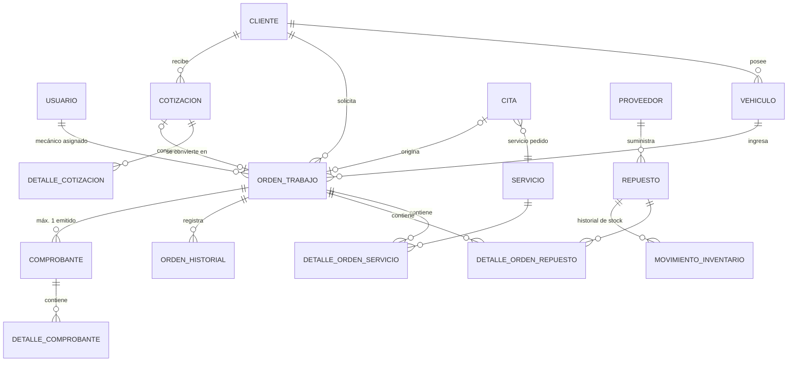
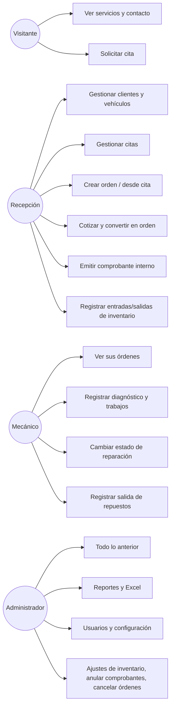
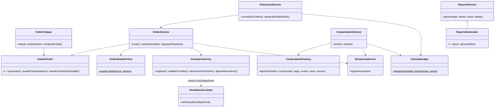
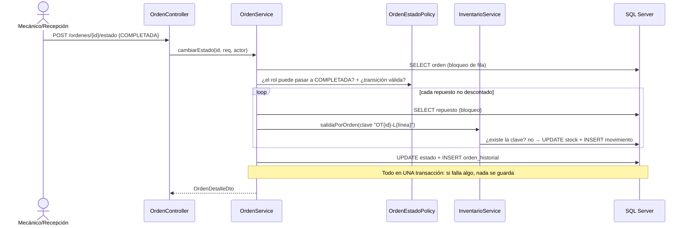
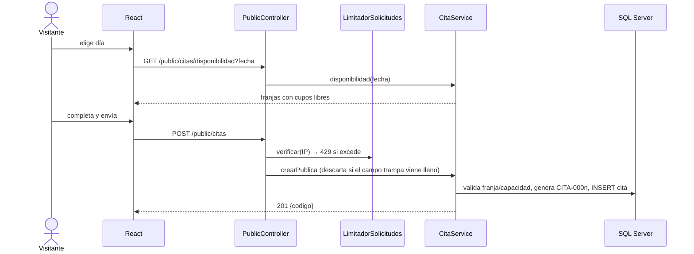

# Arquitectura de MecAuto

Los diagramas usan [Mermaid](https://mermaid.js.org/) (VS Code los muestra con la extensión «Markdown Preview Mermaid Support», y GitHub los dibuja directamente). Reflejan lo que está implementado en el código.

## 1. Vista general

```mermaid
flowchart LR
  N[Navegador<br/>React + Vite] -- "HTTPS/JSON<br/>/api/v1 + JWT" --> C
  subgraph B[Backend Spring Boot]
    C[controller<br/>@PreAuthorize por rol] --> S[service<br/>@Transactional]
    S --> R[repository<br/>Spring Data JPA]
    S --> D[domain<br/>reglas puras]
    C -.usa.-> DTO[dto + mapper]
    SEC[security<br/>JwtAuthFilter] --> C
  end
  R -- "JDBC (mssql-jdbc)" --> DB[(SQL Server<br/>MECAUTO)]
```

Capas y responsabilidades:

| Paquete | Responsabilidad |
|---|---|
| `controller` | Endpoints REST `/api/v1`, códigos HTTP, permisos por rol. Sin lógica de negocio. |
| `service` | Casos de uso y transacciones. Único lugar donde se orquestan varias tablas. |
| `domain` | Enumeraciones y reglas puras sin Spring: máquina de estados de la orden, cálculo de IGV, franjas horarias, política de permisos de estado. |
| `repository` | Acceso a datos (Spring Data JPA, consultas con bloqueo pesimista donde hace falta). |
| `entity` | Mapeo JPA de las tablas. Nunca se devuelven por la API. |
| `dto` / `mapper` | Contratos de entrada/salida (records) y conversión. Los hashes y datos internos no salen. |
| `security` / `config` | JWT, filtro de autenticación, CORS, BCrypt, inicializador del primer administrador. |
| `exception` | Excepciones de negocio y `GlobalExceptionHandler` (formato de error único). |

## 2. Modelo de datos (SQL Server)



Tablas de apoyo: `secuencia` (correlativos con bloqueo de fila) y `configuracion_taller` (clave/valor). Restricciones relevantes: `CHECK (stock_actual >= 0)`, único filtrado `UX_movimiento_idempotencia` (evita descuentos duplicados), único filtrado `UX_comprobante_orden_emitido` (un solo comprobante emitido por orden), `UNIQUE(tipo, serie, numero)`. Detalle completo en `database/schema.sql`.

El **historial de mantenimiento** de un vehículo se obtiene de las órdenes (`orden_trabajo` + `orden_historial`), sin duplicar datos en otra tabla.

## 3. Casos de uso



## 4. Clases principales (dominio y servicios)



## 5. Secuencias

### 5.1 Completar una orden (descuento de inventario)



### 5.2 Cita pública



### 5.3 Emitir comprobante

```mermaid
sequenceDiagram
  actor R as Recepción
  participant CS as ComprobanteService
  participant SQ as SecuenciaService
  participant DB as SQL Server
  R->>CS: emitir(ordenId, metodoPago)
  CS->>DB: SELECT orden (bloqueo); exige COMPLETADA y sin comprobante emitido
  CS->>SQ: siguiente(serie) (fila bloqueada)
  CS->>DB: INSERT comprobante + detalles (IGV desglosado del total)
  CS-->>R: 201 número correlativo
```

## 6. Decisiones relevantes

* **Sesión sin estado con JWT** (HS256, expira a las 8 h por defecto). El filtro vuelve a leer el usuario en cada petición: si se desactiva, su token deja de servir de inmediato.
* **El frontend guarda el token en `sessionStorage`** (se pierde al cerrar la pestaña). Es un compromiso: más simple que cookies `HttpOnly`, a cambio de ser accesible por JavaScript si hubiera XSS; React escapa el contenido por defecto y no se usa `dangerouslySetInnerHTML`.
* **`open-in-view=false`**: los servicios arman los DTO dentro de la transacción; no hay carga perezosa fuera de ella.
* **Concurrencia:** bloqueo pesimista (`PESSIMISTIC_WRITE`) en repuestos, órdenes, cotizaciones y secuencias; `@Version` como red de seguridad.
* **Desviaciones del documento académico:** Spring Data JPA para el CRUD más un DAO con JdbcTemplate para las consultas SQL directas (`dao/ClienteDAO`); SQL Server en lugar de MySQL; Guava y Commons Lang 3 usados en validaciones y utilidades; React Router/Axios sustituidos por un enrutador por hash y `fetch` propios; el historial de mantenimiento se deriva de las órdenes; la consulta pública de historial por placa se eliminó para no exponer datos de terceros.
